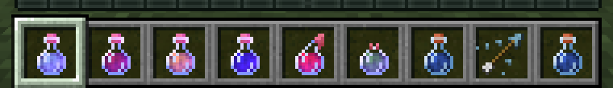
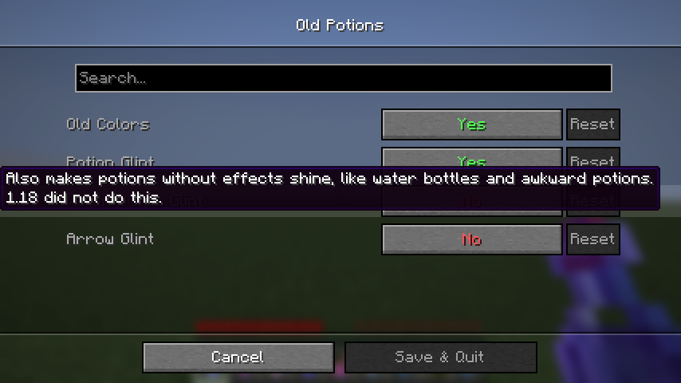

# Old Potions

potions like in 1.18. the old effect colors and the glint on potions with effects.

client side fabric mod for 1.21.11. settings through mod menu with cloth config, every part has a switch:

- **old colors**: the potion and effect colors from 1.18. this changes the color of the bottle, the swirl particles around you and the tipped arrows
- **potion glint**: potions, splash potions and lingering potions with effects shine like they did in 1.18
- **water bottle glint**: also lets potions without effects shine (off by default, 1.18 did not do this)
- **arrow glint**: tipped arrows shine too (off by default, 1.18 did not do this)

the bottle textures of 1.18 and 1.21.11 are the same, the difference you see is the colors and the glint, so this mod brings those back.

## download

`old-potions-mc1.21.11-1.0.0.jar` on the releases page. minecraft 1.21.11, fabric loader 0.16 or newer.

## pictures

the same potions with the mod on and off (speed, strength, fire resistance, night vision, splash healing, lingering poison, water, tipped arrow, awkward):

| old potions | normal 1.21.11 |
|---|---|
|  |  |

## how it works

two mixins. one changes what `MobEffect.getColor` returns to the 1.18 value for the 32 effects that existed in 1.18, the other makes `Item.isFoil` return true for potions that have effects.

all rights reserved. made by wysss.
